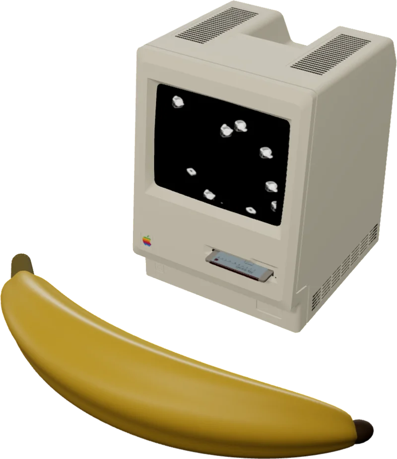
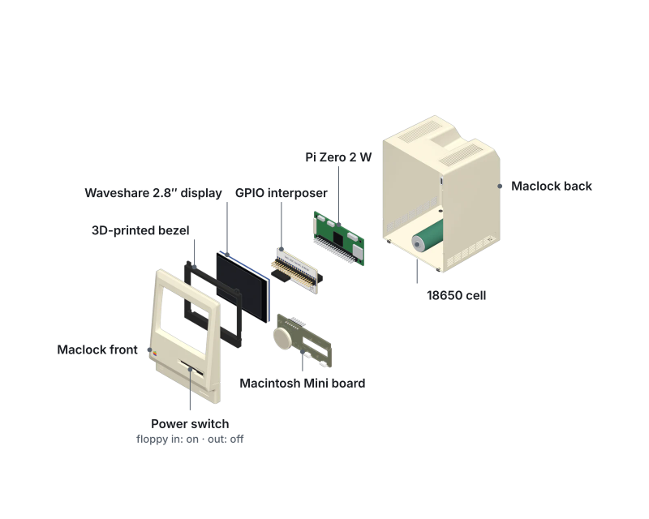
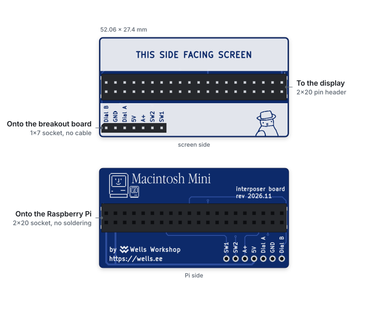
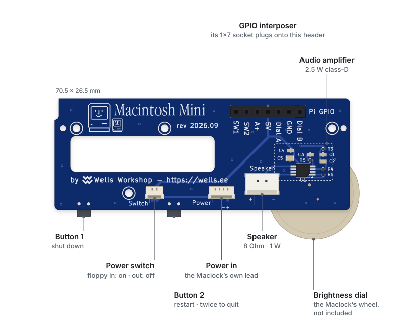

# Turn a Maclock into a working Mac

<!-- github-only -->
<p align="center">
  
</p>
<!-- /github-only -->

The [Maclock](https://amzn.to/4e7FKrw) is a novelty alarm clock shaped like the 1984 Macintosh, sold online for about $20, and I thought it was super cool the first time I saw one. The care and attention-to-detail its creator put into it really shows—the proportions are just about perfect, and the fact that inserting the little floppy disk turns it on and off is a really nice touch.

I don't really need another clock, but I *would* like a little desk toy that runs real Mac OS… and maybe an After Dark screensaver? So I replaced the Maclock's insides with a Raspberry Pi Zero 2 W and a 2.8-inch screen. Now it boots classic Mac OS, plays the startup chime, and runs vintage software. The front dial sets the screen brightness, the two buttons restart and shut down, and Wi-Fi, Bluetooth, USB, and the internal battery all work. This guide is how to build your own.

I filmed the whole build end-to-end, which you can find on [YouTube](https://www.youtube.com/watch?v=zAbAf5-H5Yo).

<!-- shop:photo -->

## Buy it or build it

<!-- shop:builds -->

<!-- github-only -->
I sell kits and finished Macs in my shop, [Wells Workshop](https://shop.wells.ee/products/macintosh-mini/?ref=gh-macintosh-mini):

- [**Fully assembled**](https://shop.wells.ee/products/macintosh-mini/?ref=gh-macintosh-mini): nothing to build. Copy over your ROM and disk image.
- [**DIY kit, pre-soldered**](https://shop.wells.ee/products/macintosh-mini/diy-kit-soldered/?ref=gh-macintosh-mini): wire it up, flash the card, close the case. No soldering.
- [**DIY kit**](https://shop.wells.ee/products/macintosh-mini/diy-kit/?ref=gh-macintosh-mini): solder the board yourself. The parts are tiny: a microscope helps.
<!-- /github-only -->

<!-- shop:open-source -->

Everything is open source, though, so you're just as welcome to order the bare board from [PCBWay](https://www.pcbway.com/project/shareproject/W654223ASS41_Untitled_kicad_pcb_95cca7e3.html) and source every part yourself from the [bill of materials](maclock-pcb/). The rest of this guide is the same either way.

<!-- /shop:open-source -->

## What you need

### Parts

- A Maclock
- A Raspberry Pi Zero 2 W (or a Pi 3 Model A+)
- A Waveshare 2.8-inch IPS LCD (the DPI version)
- The Macintosh Mini board, which connects the clock's dial, buttons, power switch, battery, and speaker to the Pi, and carries the audio amplifier
- A small speaker: 8 Ω, 1 W, 28–40 mm, with a JST PH 2.0 mm plug
- A 3D-printed screen bezel ([STL file](maclock-screen-bezel/))
- A way to connect the board to the Pi: the GPIO interposer (recommended), or 7 jumper wires with a female end on one side
- A 32 GB microSD card
- Optional: a micro-USB to USB-A cable, to add a USB port on the back for a keyboard or mouse

<!-- github-only -->
**Where to buy:** [Maclock](https://amzn.to/4e7FKrw) · [Raspberry Pi Zero 2 W](https://amzn.to/4ac7FVR) · [Waveshare 2.8-inch LCD](https://amzn.to/4ue5GaP) · [Macintosh Mini board](https://www.pcbway.com/project/shareproject/W654223ASS41_Untitled_kicad_pcb_95cca7e3.html) from PCBWay ([$5 off with my referral code](https://pcbway.com/g/AsfKU9)) · [micro-USB to USB-A cable](https://www.aliexpress.us/item/3256807845070147.html?gatewayAdapt=glo2usa#nav-specification) (choose `Color: OTGV8DO-AFH`) · the speaker and the GPIO interposer, from [Wells Workshop](https://shop.wells.ee/products/macintosh-mini/?ref=gh-macintosh-mini)
<!-- /github-only -->

### Tools

- A thin opening pick or metal pry tool (the kind used to open iPods)
- A small screwdriver
- Flush cutters
- A soldering iron, if you use wires instead of the interposer
- A rotary tool such as a Dremel, if you add a USB port

### Software

- A Mac ROM file. I recommend the [Performa ROM](https://www.redundantrobot.com/sheepshaver) based on my testing.
- A Mac OS disk image with System 7.0 to 8.5. The [BlueSCSI image library](https://bluescsi.com/docs/BlueSCSI-Images) has ready-made ones.

<picture>
  <source media="(prefers-color-scheme: dark)" srcset="docs/drawings/exploded-dark.svg">
  
</picture>

## 1. Open the Maclock

I'll be honest: I *really* hate this part. **Leave the screws on the back alone.** They're real, but they don't hold the front and back together: plastic clips do.

Push a thin opening pick or a metal pry tool, the kind used to open iPods, into the seam between the front and back shells, and work it in until you **feel it click all the way down**. Watch [3:20 in the video](https://www.youtube.com/watch?v=zAbAf5-H5Yo&t=200s) to see how I did it. Then pry, and the clip should come free. The first clip is the hardest, and there's no trick to it. Once it gives, the rest come apart much more easily. Go slowly, and try not to slice your fingers while you're at it, but don't panic if a clip breaks: it isn't a disaster.

Inside, unscrew the clock board and screen, unplug their connectors, and lift them out. **Keep the battery and its charging board.** My custom PCB takes the clock's 4-wire power plug and 2-wire switch plug, so the clock's own power switch still works: push the little floppy disk into its slot to turn the Mac on, and pull it out to turn it off. That was one of my favorite details of the clock, so I made sure it survived.

The touch-sensitive pad on top of the case isn't used: cut its wires, or leave them where they are.

## 2. Connect the Pi to the screen and the board

My board talks to the Pi over five GPIO pins: the dial (two pins), the two buttons, and the audio. The Waveshare display plugs onto the Pi's 40-pin header and **uses some of the same pins**, and when it does, the buttons and dial behave erratically. There are two ways around this, and I recommend the first.

**Use the GPIO interposer (recommended).** Press the interposer onto the Pi's header, then press the display onto the interposer. The interposer steals the five pins away from the display and plugs straight into the custom PCB: no cable. Nothing on the Pi is cut, bent, or soldered.

<picture>
  <source media="(prefers-color-scheme: dark)" srcset="docs/drawings/interposer-dark.svg">
  
</picture>

**No interposer (requires soldering):** Cut or desolder pins 13, 19, 23, 35, and 37 on the Pi's header so they don't reach the display. Then solder a wire to the back of the Pi at each pin in the table below, and plug the female ends onto the board's "Pi GPIO" header:

| Board pin | Pi pin | What it carries |
| --- | --- | --- |
| 5V | 2 | Power from the clock to the Pi |
| GND | 6 | Ground |
| SW1 | 13 | The right button |
| Dial B | 19 | Brightness dial |
| Dial A | 23 | Brightness dial |
| A+ | 35 | Audio to the amplifier |
| SW2 | 37 | The left button |

## 3. Fit the board and connect the clock's plugs

I designed my board as a **drop-in replacement** for the clock board: it fits where the old board was, the same screws hold it in, and the dial and the two buttons sit exactly where the clock's did. It has three small connectors, labelled on the board:

- **Power:** the clock's 4-wire plug. The board takes the battery's power and ground from it and passes them to the Pi.
- **Switch:** the clock's 2-wire power-switch plug.
- **Speaker:** the speaker's 2-wire plug. Either way round works.

The clock's power and switch plugs are 1.25 mm, and the board's Power and Switch sockets are 1.0 mm, so the boards from my shop come with **two short adapter cables** to go between them. **If you order a board yourself from PCBWay, it's the earlier rev 2026.05, which has solder pads instead of sockets.**

The Pi runs straight from the external USB-C port or internal battery, at **about 4 V** rather than the 5 V a Pi is rated for, even with the charge cable plugged in. You'd think that isn't enough for a Pi, and so did I, but it runs just fine. See [Known issues](maclock-build/README.md#known-issues) for what it does to the audio.

<picture>
  <source media="(prefers-color-scheme: dark)" srcset="docs/drawings/board-dark.svg">
  
</picture>

## 4. Fit the screen

The bezel took me some trial and error to get right. You will need to use side cutters to **nip away the plastic on the left side of the screen housing** to make the bezel fit (see [12:54 in the video](https://www.youtube.com/watch?v=zAbAf5-H5Yo&t=774s)). **Print it at 0.2 mm layers with no supports**; black PLA or PETG hides it best. It perfectly centers the 2.8-inch panel inside the clock's original screen opening.

The bezel screws in at the top, into the posts that held the clock's screen, with the same screws. Clips along its bottom edge hold the bottom of the screen. The Pi needs no mount of its own: it hangs off the back of the screen, plugged into it directly or through the interposer. **No tape or glue is needed anywhere.**

**The fit should be snug, not tight.** If the panel has to be forced in, sand the bezel's inner edges or print it slightly larger: pressing a tight bezel onto the LCD can crack it or cause artifacts to appear on screen. And if you end up with a screw left over, don't worry—every good electronics project has one.

**Optional: a USB port on the back.** The back shell has no opening for one, so cut a rectangular hole with a rotary tool such as a Dremel. The top right corner of the back shell, where the fake battery door is, works best. Glue or otherwise mount the cable's USB-A end inside the rear shell, and plug its micro-USB end into **the Pi's data port (marked USB, not PWR)**.

## 5. Install the software

I wanted this part to be easy, so I wrote a script that does nearly everything for you 🙂

1. Flash **Raspberry Pi OS Lite (64-bit)** onto the microSD card with [Raspberry Pi Imager](https://www.raspberrypi.com/software/). **Set your Wi-Fi network and turn on SSH** in its settings, so you can reach the Pi without a keyboard.
2. Boot the Pi and find its IP address.
3. **Rename your ROM file to `ROM`**, with no extension, and copy it and your disk image to the Pi's home folder:

   ```bash
   scp ROM yourdisk.hda <user>@<pi_ip>:~/
   ```

   Disk images named `.hda`, `.dsk`, `.img`, `.hfv`, or `.sparsebundle` work. `.dmg`, `.image`, `.smi`, `.toast`, and zipped or StuffIt files do not.

4. Connect to the Pi over SSH and run the installer:

   ```bash
   curl -fsSL https://raw.githubusercontent.com/wr/macintosh-mini/main/setup.sh | bash
   ```

   It finds the ROM and disk image, installs the emulator, the display drivers, and the button and dial services, then restarts the Pi. **The Pi then boots straight into Mac OS.**

   Before I snap the case shut, I always push the floppy in and wait for the chime. Closing it up before the first test feels like bad luck.

**Updating.** Run the installer again at any time. It keeps your disk image and settings.

**Don't want to run the script?** The [manual install](maclock-build/README.md) walks through what the installer does, step by step.

## Using your Mac

- **The dial** sets the screen brightness. The installer script can also dim the screen after sunset and turn it off overnight ([night dimming](maclock-build/README.md#night-dimming-optional)).
- **The right button** shuts the Pi down safely.
- **The left button** restarts Mac OS, with the crash sound. Pressed twice quickly, it quits to the Pi's command line instead.
- **To change Wi-Fi networks**, hold the left button for 10 seconds. The Mac beeps, shows a QR code and offers its own Wi-Fi network, `Macintosh Mini XXXX`. Join it from your phone, and a page opens where you pick your network. Press the left button again to cancel. A Mac with no saved Wi-Fi does this by itself when it starts.
- To change what either button does, edit `COMMANDS`, `DOUBLE_COMMANDS`, and `HOLD_COMMANDS` in [`button_handler.py`](maclock-build/button_handler.py).
- **Shut Down** in Mac OS (Special → Shut Down) quits to the Pi's command line, and **Restart** restarts the Mac. A crash restarts it on its own. Type `macintosh` at the command line to start the Mac again.
- **Networking** works out of the box. In Mac OS, set TCP/IP to DHCP.

## Troubleshooting

<!-- shop:toggles -->

**The buttons or dial do strange things.** The display is using pins the board needs. Use the GPIO interposer, or check that pins 13, 19, 23, 35, and 37 don't reach the display.

**The dial jumps or turns the wrong way.** The encoder is worn. A good one clicks firmly; a mushy one can't be fixed in software. Clean its contacts or replace it.

**The disk image won't boot.** Check its format: `.dmg`, `.image`, `.smi`, and `.toast` files and anything still zipped don't work. Convert it to a raw image, or use one from the BlueSCSI library.

**The Mac has moved, or the Wi-Fi password changed.** Hold the left button for 10 seconds and set up the new network from your phone (see [Using your Mac](#using-your-mac)).

**The Pi drops off Wi-Fi or SSH is slow to answer.** The Pi Zero's Wi-Fi power saving is on. The installer turns it off; if you set the Pi up by hand, see [Keep the Wi-Fi awake](maclock-build/README.md#4-keep-the-wi-fi-awake).

**The speaker buzzes at low brightness.** The Pi's analogue audio picks up noise from the display's backlight signal. A USB audio adapter removes it. Powering it from a USB-C power source rather than a USB-A 5 V power brick can also help.

**The speaker burbles on battery.** On rev 2026.09 boards, noise from the Pi's supply reaches the audio. The clock's charging board puts out about 4 V, not 5 V, even with the charge cable plugged in. Turn the brightness down. The next board revision is designed to remove it; see [Known issues](maclock-build/README.md#known-issues).

**The hostname changes back after a restart.** Raspberry Pi OS resets it on every boot. Give the installer a hostname and it fixes this, or see [Known issues](maclock-build/README.md#known-issues).

<!-- /shop:toggles -->

Anything else: open an issue on [GitHub](https://github.com/wr/macintosh-mini/issues).

## Questions

<!-- shop:toggles -->

**Which versions of Mac OS does it run?** System 7.0 to 8.5 with Basilisk II, or Mac OS 8.1 and later with SheepShaver.

**Is a ROM included?** No. Apple's ROMs are copyrighted; use one from a Mac you own.

**Does it still work as a clock?** In a way: the clock board comes out, but Mac OS shows the time. For the full clock face, install [Big Maclock](https://tinkerdifferent.com/threads/big-maclock-a-software-inspired-version-of-the-desk-toy-clock.5165/), a classic Mac clock app inspired by the Maclock.

**How long does the build take?** About an hour with the pre-soldered kit, from opening the clock to the System 7 desktop. Allow another hour to solder the DIY kit.

**Which Raspberry Pi models work?** The Pi Zero 2 W and the Pi 3 Model A+ are tested. Other models may work but haven't been tried. The original Pi Zero and Zero W can't run the 64-bit Pi OS the installer needs.

<!-- /shop:toggles -->

Good luck with yours, and let me know how it turns out.

---

The Macintosh Mini is open source. The board and bezel are licensed under [CERN-OHL-S-2.0](maclock-pcb/LICENSE), the software under [GPL-3.0-or-later](LICENSES/GPL-3.0-or-later.txt), and this guide under [CC BY-SA 4.0](LICENSES/CC-BY-SA-4.0.txt).

As an Amazon Associate I earn from qualifying purchases.

<!-- github-only -->
This guide is also on my site, at [wells.ee/projects/macintosh-mini](https://wells.ee/projects/macintosh-mini/?ref=gh-macintosh-mini), which copies it from here: edit this file, not that page.
<!-- /github-only -->
