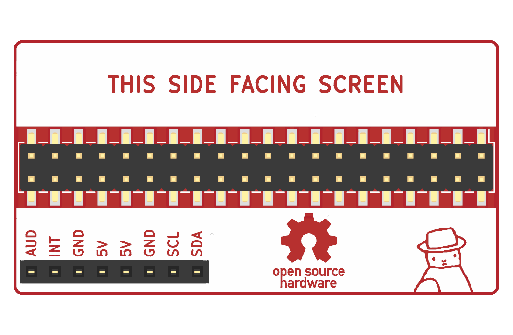

# Macintosh Mini GPIO interposer

 

A 64.6 × 27.4 mm, 2-layer, 0.8 mm thick KiCad 10 board that sits between the Raspberry Pi (a Zero 2 W or a 3 A+) and the Waveshare 2.8" DPI display. Order it fully assembled — no soldering, and no bent, cut, or desoldered pins on the Pi.

Current revision: 2027.01, for the rev 2027.01 [main board](../maclock-pcb/). **It hasn't been built or tested yet, and the Pi software for it isn't written.** The two revisions don't mix, because their link pins differ: with a rev 2026.11 main board, use the 2026.11 interposer at commit [`e557f70`](https://github.com/wr/macintosh-mini/tree/e557f70d8a1d978d0e488f638d03199df252ab32/maclock-interposer).

An SMD pin header on top plugs into the display and an SMD socket underneath plugs onto the Pi. The socket sits 6 mm lower than the header, so a Pi 3 A+ (65 × 56 mm) clears the handle at the top of the Maclock's rear shell. 35 pins run from one to the other, one via each. Header pins 13, 19, 23, 35 and 37 connect to the Pi side **only** and never reach the display. Four of them, plus 5V and GND, come out on a straight 1×8 female socket (J2) on the screen side at the GPIO 21 end. J2 plugs straight onto the main board's `Link` header, pin 1 onto pin 1, so its pin 1 (SDA) sits at the end away from GPIO 21. A straight 8-way male-to-female Dupont cable works too. Pin 37 (GPIO 26) is unused.

The display uses the Pi's hardware I²C pins for its sync signals, so the Pi reaches the main board's input chip and battery gauge over a software I²C bus on GPIO 10 and 11. Three resistors on the Pi side complete the link. R1 and R2 pull SDA and SCL up to the Pi's 3.3 V. R3 pulls up INT, which the main board's input chip only ever pulls low. The main board has none of these, because the ESP32-P4 build brings its own. The Pi's own pull-up or pull-down on GPIO 10, 11 and 27 should be switched off in software.

The board is drawn the way it sits in the Maclock: Pi mounted upside-down, seen from the screen. Order it **0.8 mm thick**, with **red solder mask and white silkscreen** like the 2027.01 main board, so it can't be paired with a blue 2026.11 board by mistake. The screen side is inverted (silk is the background; the lettering, the open-hardware logo and the character are bare mask). Branding is on the Pi side, and J2's pin labels are on both sides.

| J2 pin | Silk | Net   | Pi header pin | GPIO |
| ------ | ---- | ----- | ------------- | ---- |
| 1      | SDA  | SDA   | 19            | 10   |
| 2      | SCL  | SCL   | 23            | 11   |
| 3      | GND  | GND   | all GNDs      | —    |
| 4      | 5V   | 5V    | 2, 4          | —    |
| 5      | 5V   | 5V    | 2, 4          | —    |
| 6      | GND  | GND   | all GNDs      | —    |
| 7      | INT  | INT   | 13            | 27   |
| 8      | AUD  | AUDIO | 35            | 19   |

## Bill of materials

| Ref | Qty | Part                                                                  | LCSC                                                                  | Notes                                             |
| --- | --- | --------------------------------------------------------------------- | --------------------------------------------------------------------- | ------------------------------------------------- |
| J1  | 1   | 2×20 female socket, 2.54 mm, SMD, 7.1 mm, two locating pegs — Liansheng `FH-00148` | [`C2685092`](https://www.lcsc.com/product-detail/C2685092.html) | **Bottom** side, plugs onto the Pi. LCSC had 3,698 in stock on 2026-11-28 |
| J3  | 1   | 2×20 pin header, 2.54 mm, SMD — Hanbo `HB-PH9-254220PB2GOP`            | [`C6332245`](https://www.lcsc.com/product-detail/C6332245.html)       | Top side, plugs into the display                  |
| J2  | 1   | 1×8 female header (socket), 2.54 mm, 7.1 mm, THT — XFCN `PM254V-11-08-H71-U` | [`C55218707`](https://www.lcsc.com/product-detail/C55218707.html) | Top (screen) side. LCSC had 190 in stock on 2026-11-27 |
| R1, R2 | 2 | 2.2 kΩ ±1% 0402 — UNI-ROYAL `0402WGF2201TCE`                          | [`C25879`](https://www.lcsc.com/product-detail/C25879.html)           | Bottom side. I²C pull-ups on SDA and SCL          |
| R3  | 1   | 10 kΩ ±1% 0402 — UNI-ROYAL `0402WGF1002TCE`                            | [`C25744`](https://www.lcsc.com/product-detail/C25744.html)           | Bottom side. Pull-up on INT                       |

Both sides carry parts, so order two-sided assembly. J1's locating pegs are 1.4 mm long, so on a 0.8 mm board they stick out of the screen side beside J3: ask for the screen side (J3) to be pasted and placed first. J1's footprint (in `maclock-interposer.pretty`) follows its datasheet: 2.3 × 1.02 mm pads and two 1.2 mm holes for its pegs. J3 still uses KiCad's generic land (3.15 × 1.0 mm pads, ±2.52 mm from the centreline); Hanbo's drawing suggests 3.2 × 1.02 mm pads with their outer ends 8.6 mm apart, so check J3 against it before ordering.

## Use

Stack Pi → interposer → display, with the side marked `THIS SIDE FACING SCREEN` toward the display. Plug J2 straight onto the main board's `Link` header, `SDA` (J2's square pad) onto `SDA`. Each side's labels then line up with the other's.

The interposer adds about 10.4 mm between the Pi and the display (7.1 mm socket + 0.8 mm PCB + 2.54 mm header base). The Pi sits 6 mm lower than the display's socket, so a Pi 3 A+ ends about 3 mm above the display's top edge and a Zero 2 W about 23 mm below it. The board reaches 4.2 mm past the Pi's header edge. The Pi's two mounting holes on its header side line up with H1 and H2: fix them with M2.5 screws and spacers 9.6 mm long (the Pi's 2.5 mm header base plus J1). That isn't a stock length: 10 mm spacers work but leave the Pi 0.4 mm short of fully seated. J2 stands 7.1 mm off the screen side, and the Dupont plug in it points toward the display — check both against your case and the display board before ordering.

## License

CERN-OHL-S-2.0, same as the [main board](../maclock-pcb/README.md#license) — see [`LICENSE`](./LICENSE).
