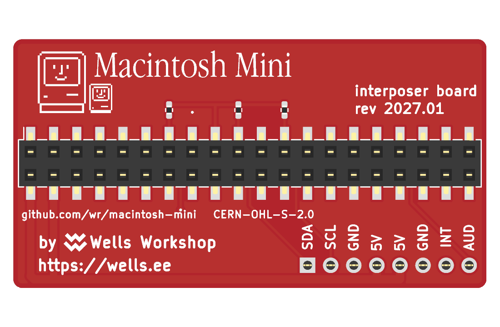

# Macintosh Mini GPIO interposer

 

A 52 × 27.4 mm, 2-layer KiCad 10 board that sits on the 40-pin header between the Pi Zero 2 W and the Waveshare 2.8" DPI display. Order it fully assembled — no soldering, and no bent, cut, or desoldered pins on the Pi.

Current revision: 2027.01, for the rev 2027.01 [main board](../maclock-pcb/). **It hasn't been built or tested yet, and the Pi software for it isn't written.** The two revisions don't mix, because their link pins differ: with a rev 2026.11 main board, use the 2026.11 interposer at commit [`ea41efe`](https://github.com/wr/macintosh-mini/tree/ea41efe2434ef0056f3ba3236e3c8bb0ac9fd945/maclock-interposer).

An SMD socket underneath plugs onto the Pi and an SMD pin header on top plugs into the display. 35 pins pass straight through (one via each). Header pins 13, 19, 23, 35 and 37 connect to the Pi side **only** and never reach the display. Four of them, plus 5V and GND, come out on a straight 1×8 female socket (J2) on the screen side at the GPIO 21 end. J2's pins are in the same order as the main board's `Link` header, so one straight 8-way male-to-female Dupont cable connects the two. Pin 37 (GPIO 26) is unused.

The display uses the Pi's hardware I²C pins for its sync signals, so the Pi reaches the main board's input chip and battery gauge over a software I²C bus on GPIO 10 and 11. Three resistors on the Pi side complete the link. R1 and R2 pull SDA and SCL up to the Pi's 3.3 V. R3 pulls up INT, which the main board's input chip only ever pulls low. The main board has none of these, because the ESP32-P4 build brings its own.

The board is drawn the way it sits in the Maclock: Pi mounted upside-down, seen from the screen. Order it with **red solder mask and white silkscreen**, like the 2027.01 main board, so it can't be paired with a blue 2026.11 board by mistake. The screen side is inverted (silk is the background, the lettering is bare mask). Branding is on the Pi side, and J2's pin labels are on both sides.

| J2 pin | Silk | Net   | Pi header pin | GPIO |
| ------ | ---- | ----- | ------------- | ---- |
| 1      | SDA  | SDA   | 19            | 10   |
| 2      | SCL  | SCL   | 23            | 11   |
| 3      | GND  | GND   | all GNDs      | —    |
| 4      | 5V   | 5V    | 2, 4          | —    |
| 5      | 5V   | 5V    | 2, 4          | —    |
| 6      | GND  | GND   | all GNDs      | —    |
| 7      | INT  | INT   | 13            | 27   |
| 8      | AUD  | AUDIO | 35            | 19   |

## Bill of materials

| Ref | Qty | Part                                                                  | LCSC                                                                  | Notes                                             |
| --- | --- | --------------------------------------------------------------------- | --------------------------------------------------------------------- | ------------------------------------------------- |
| J1  | 1   | 2×20 female socket, 2.54 mm, SMD, 8.5 mm — Hong Cheng `HC-PM254-8.5H-2x20PS` | [`C22436166`](https://www.lcsc.com/product-detail/C22436166.html) | **Bottom** side, plugs onto the Pi                |
| J3  | 1   | 2×20 pin header, 2.54 mm, SMD — Hanbo `HB-PH9-254220PB2GOP`            | [`C6332245`](https://www.lcsc.com/product-detail/C6332245.html)       | Top side, plugs into the display                  |
| J2  | 1   | 1×8 female header (socket), 2.54 mm, 7.1 mm, THT — XFCN `PM254V-11-08-H71-U` | [`C55218707`](https://www.lcsc.com/product-detail/C55218707.html) | Top (screen) side. LCSC had 190 in stock on 2026-11-27 |
| R1, R2 | 2 | 2.2 kΩ ±1% 0402 — UNI-ROYAL `0402WGF2201TCE`                          | [`C25879`](https://www.lcsc.com/product-detail/C25879.html)           | Bottom side. I²C pull-ups on SDA and SCL          |
| R3  | 1   | 10 kΩ ±1% 0402 — UNI-ROYAL `0402WGF1002TCE`                            | [`C25744`](https://www.lcsc.com/product-detail/C25744.html)           | Bottom side. Pull-up on INT                       |

Both sides carry parts, so order two-sided assembly. Before ordering, check the J1/J3 drawings for locating pegs — the footprints are KiCad's generic peg-less SMD lands (3.0 / 3.15 × 1.0 mm pads, ±2.52 mm from the centreline).

## Use

Stack Pi → interposer → display, with the side marked `THIS SIDE FACING SCREEN` toward the display. Run a straight 1×8 male-to-female Dupont cable from J2 to the main board's `Link` header, pin 1 (`SDA`, square pad, GPIO 21 end) to pin 1 (`SDA`).

The interposer adds about 12.5 mm between the Pi and the display (8.5 mm socket + 1.6 mm PCB + 2.5 mm header base), and the board reaches ~10.5 mm past the Pi's header edge. J2 stands 7.1 mm off the screen side, and the Dupont plug in it points toward the display — check both against your case and the display board before ordering.

## License

CERN-OHL-S-2.0, same as the [breakout PCB](../maclock-pcb/README.md#license) — see [`LICENSE`](./LICENSE).
